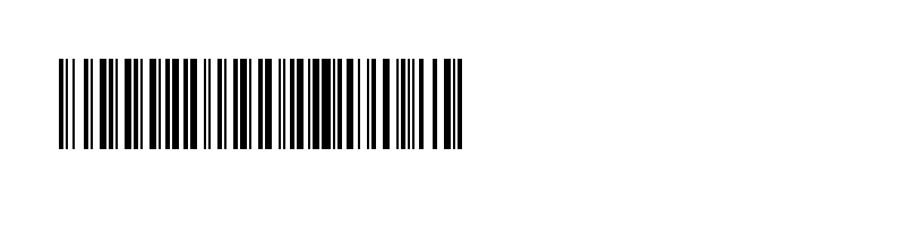
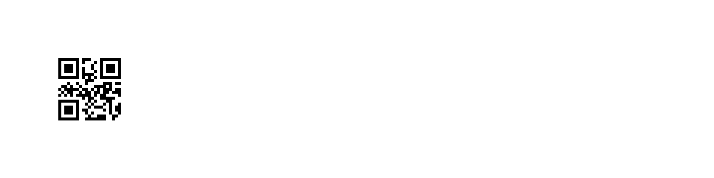

# Echo barcode rendering acceptance

On November 2, 2026, the real renderer produced the two labels below from the local server's published Echo template revision 1. ZXing 3.5.3 independently decoded the emitted raster pixels, preserving both the symbology and the exact value. The live server's published revision and stock were checked again after rendering and matched the tested descriptor.

| Input | Decoded format | Decoded value | Raster size |
| --- | --- | --- | --- |
| Code128 | `CODE_128` | `QQQ-TEST-123456` | 600 × 180 dots |
| QR | `QR_CODE` | `001234567890` | 208 × 205 dots, including byte padding |

The stock is 101600 × 25400 microns (4 × 1 inches) at 300 dpi: a 1200 × 300 dot label. Both graphics start at (48, 48), fit inside the published printable margins and fit rectangle, and contain the requested barcode. The checks validated the ZPL envelope, raster byte counts, output hashes, placement, dimensions, decoded format and string-exact value. The QR value was never converted to a number.

The renderer was the owner's `IsolatedRendererBridge` over its explicit trusted-local Docker exchange, using image `sha256:c124af0d890f1bb206422e97a1f997d863ea6a8b2225cecf32be726a252c9ee4`. This is development verification, **not production sandbox qualification**. The renderer received fixed test record contexts; no hardware scan was fabricated and no printer job was sent.

The [machine-readable receipt](echo-renderer-acceptance.json) records the original ZPL hashes and all checks. The previews below were reconstructed from those ZPL raster bytes, not generated separately from the expected values.

## Code128 test input

Open [the full-size Code128 image](barcodes/code128-preview.png) and scan it once in Echo for the physical test.

## Leading-zero QR test input

Open [the full-size QR image](barcodes/qr-preview.png) when testing leading-zero preservation.

## Remaining acceptance

These two decoded artifacts prove these rendering cases. They do not prove physical trigger capture, printer delivery, printed-label readability, other inputs or symbologies, or production release readiness. Complete the TC22 scan → server print → printed-label rescan, deliberate repeated scans and Leave/error recovery. Keep the remaining device/provider, barcode-fidelity, dependency-publication and primary CI gates open.
